

  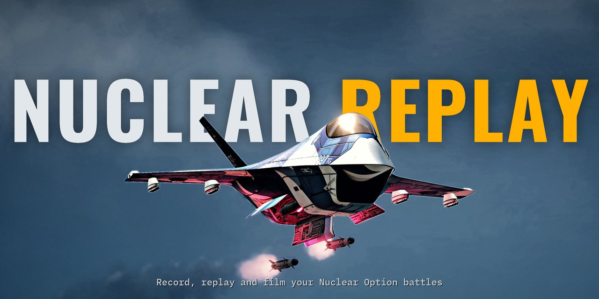

  <picture>
    <source media="(prefers-color-scheme: dark)" srcset="docs/media/logo-dark.png">
    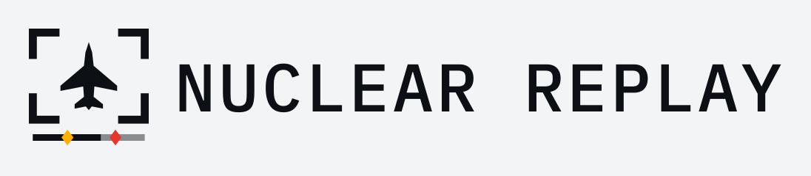
  </picture>

  <b>Record your Nuclear Option matches and watch them back from any angle, then clip the best moments.</b>

  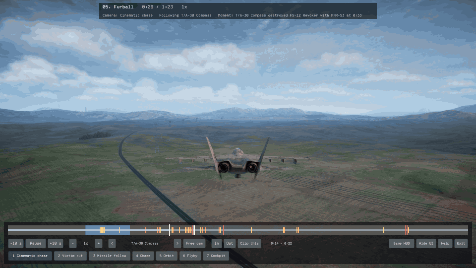

Nuclear Replay is a free mod for [Nuclear Option](https://store.steampowered.com/app/2168680/). It is
fan-made and not affiliated with Shockfront Studios. It is a beta.

## What it does

- **Records every match you host.** Single-player missions and multiplayer matches you host are
  recorded on their own. You do not have to start anything.
- **Replays inside the game.** Click **Replays** in the main menu and pick a match. The game plays it
  again with its own aircraft, missiles and explosions.
- **A timeline of the action.** Missile launches show as amber marks and kills as red marks. Click a
  mark to jump to that moment.
- **Seven cameras and a free camera.** Cinematic chase, victim cut, missile follow, chase, orbit,
  flyby and cockpit. Or fly the camera yourself.
- **Full control of time.** Pause, skip 10 seconds, and play from 0.25x to 4x speed.
- **Clips with one key.** Mark the start and the end, press **C**, and the game records that part as an
  MP4 video at 60 fps and your screen's resolution.

## Gallery

### In the game

| | |
|---|---|
| 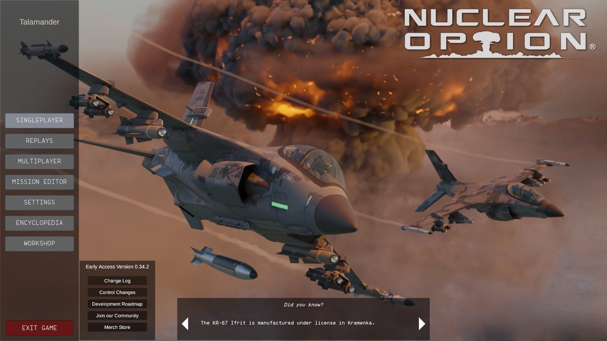 | 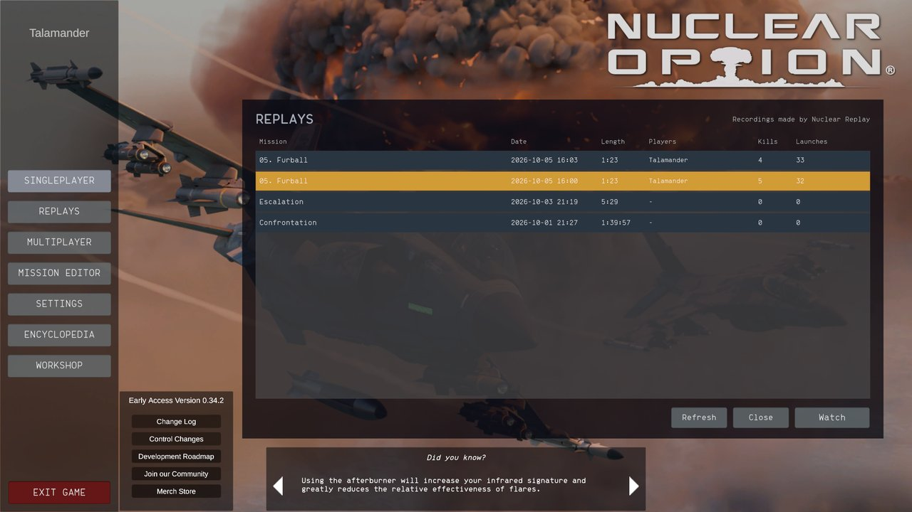 |
| The **Replays** button in the main menu. | Your recorded matches, with their length, kills and launches. |
| 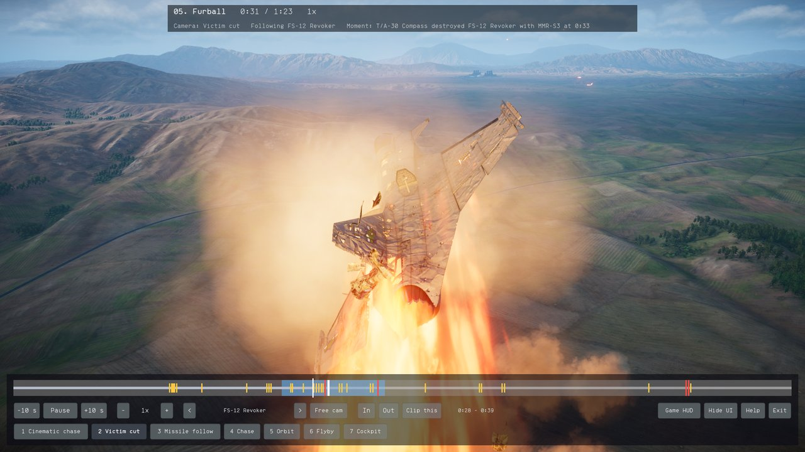 | 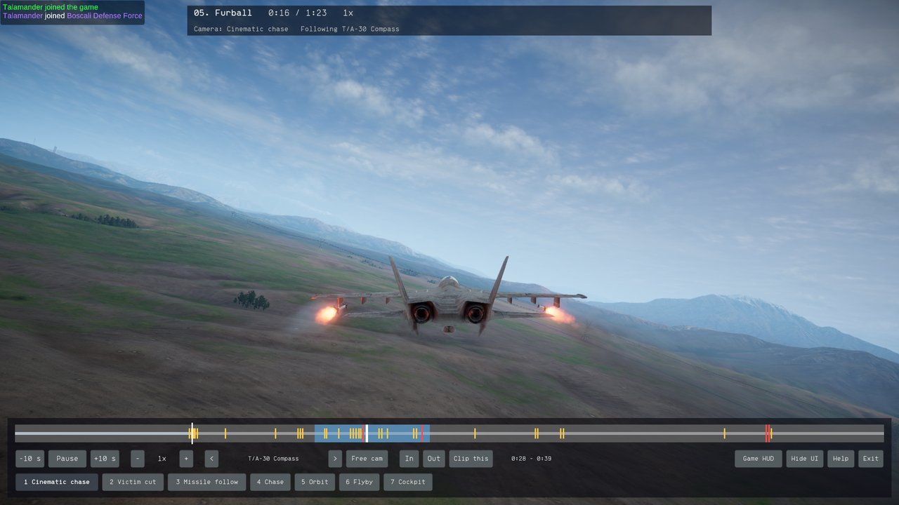 |
| The victim cut camera at the moment of a kill. | The cinematic chase camera as two missiles leave the rails. |
| 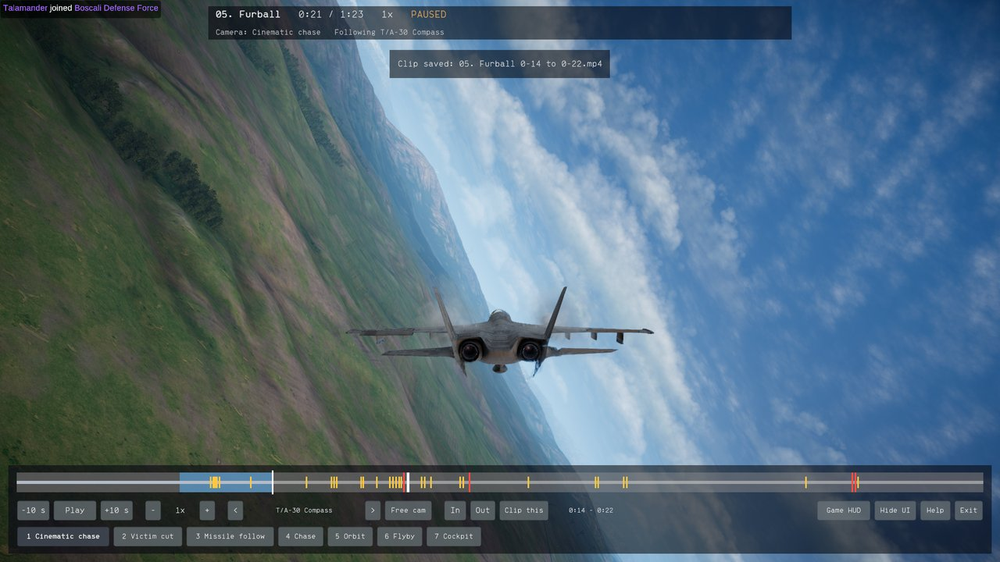 | 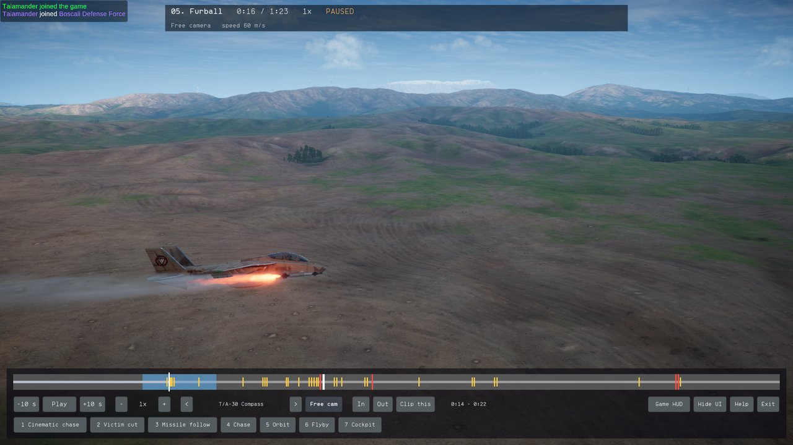 |
| A clip range on the timeline, just after the clip was saved. | The free camera, parked beside a missile launch. |
| 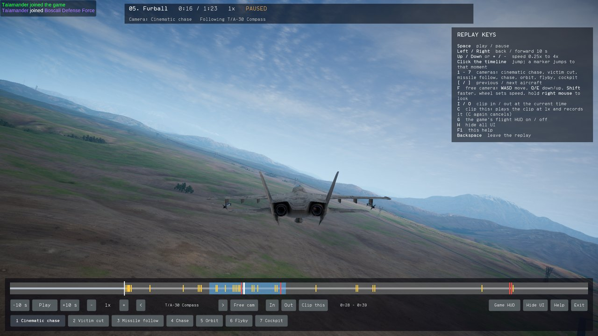 | |
| Press **F1** for every key. | |

### Made with Nuclear Replay

Stills from a real recorded match, filmed with the replay camera and colour graded.

| | |
|---|---|
| 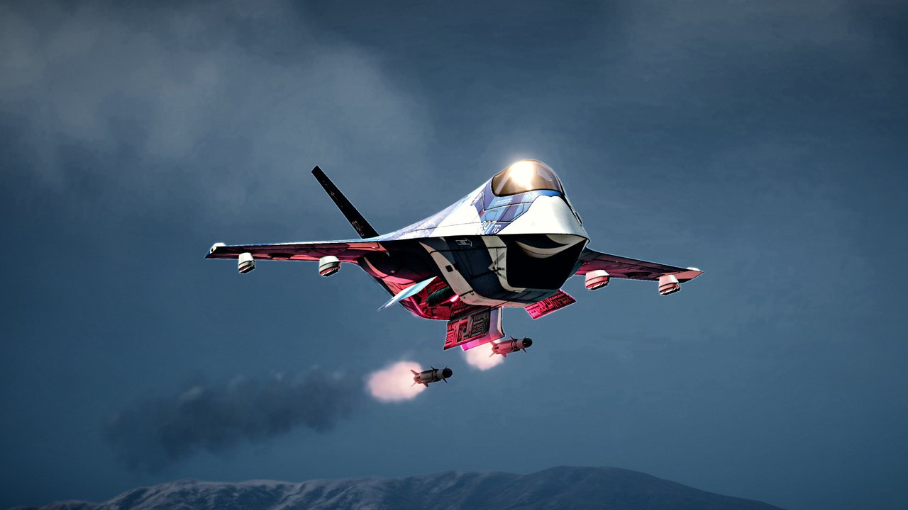 | 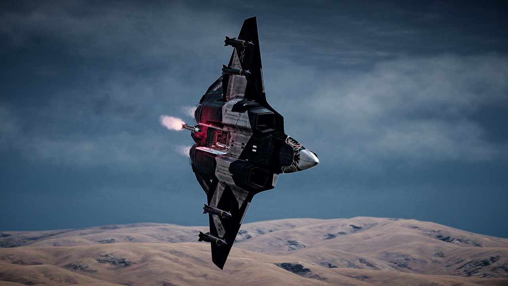 |
| 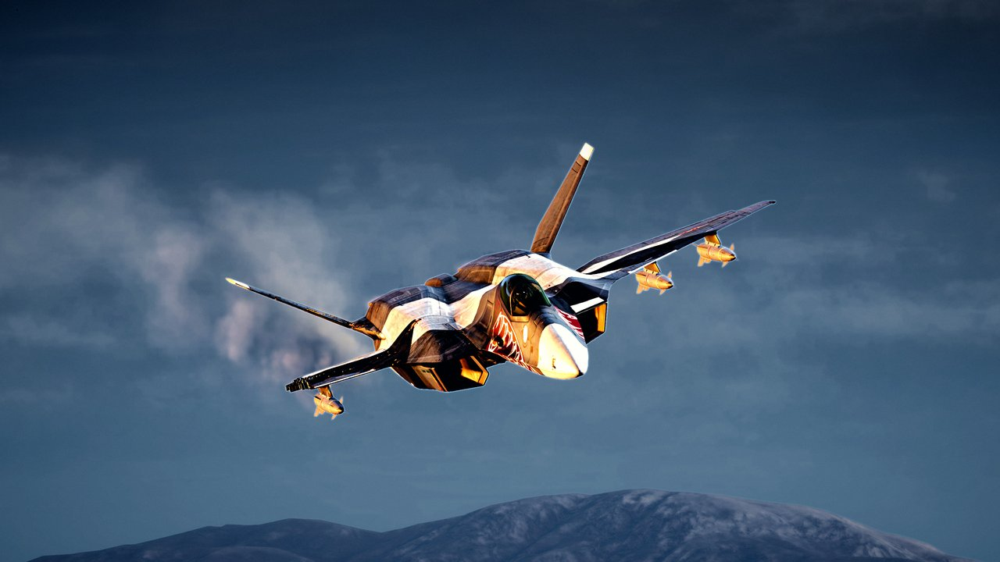 | 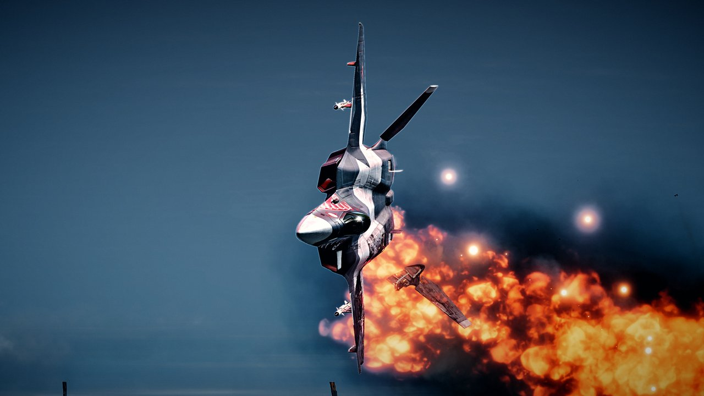 |

## Install

You need Nuclear Option from Steam.

### By hand

1. Install [BepInEx 5](https://github.com/BepInEx/BepInEx/releases) (the x64 version for Windows)
   into your Nuclear Option folder, if it is not there yet. BepInEx is the mod loader most Nuclear
   Option mods use. On Linux, also set this Steam launch option for the game:
   `WINEDLLOVERRIDES="winhttp=n,b" %command%`
2. Download `NuclearReplay-<version>-plugins.zip` from
   [Releases](https://github.com/Talamander/nuclear-replay/releases).
3. Make the folder `BepInEx/plugins/NuclearReplay` in your Nuclear Option folder and unzip the files
   into it.
4. Start the game. The main menu now has a **Replays** button.

If you already use other BepInEx mods, they keep working. Nuclear Replay only adds its own folder.

### With the NOMM mod manager (not listed yet)

Nuclear Replay is not in NOMM, the Nuclear Option mod manager, yet. It has been submitted to NOMNOM,
the list NOMM installs from, and is waiting for review
([KopterBuzz/NOMNOM#433](https://github.com/KopterBuzz/NOMNOM/pull/433)). Until it is listed, install it
by hand as above. Once it is listed, you can install it in NOMM like any other mod; NOMM also installs
BepInEx, the mod loader that Nuclear Replay needs, and it takes over a manual install in the same folder.

## How to use it

### Record a match

Host a mission and play. That is all. Recording is automatic.

Only the host records. If you join someone else's server, nothing is recorded.

### Watch it

Click **Replays** in the main menu and pick a match.

These are the keys that matter most. Press **F1** in a replay for the full list.

| Key | What it does |
|---|---|
| Space | Play or pause |
| Left / Right | Back or forward 10 seconds |
| Up / Down | Faster or slower (0.25x to 4x) |
| 1 to 7 | Cameras: cinematic chase, victim cut, missile follow, chase, orbit, flyby, cockpit |
| [ and ] | Previous or next aircraft |
| F | Free camera: WASD to move, Q and E for down and up, hold the right mouse button to look |
| I and O | Clip start and clip end at the current time |
| C | Clip this |
| H | Hide all controls |
| Backspace | Leave the replay |

You can also click anywhere on the timeline to jump there.

### Make a clip

1. Go to the start of the moment you want and press **I**.
2. Go to its end and press **O**. The range shows in blue on the timeline.
3. Press **C**. The replay plays that range once at normal speed while it records. Press **C** again
   to cancel.

The first time you press **C**, the game asks before it downloads FFmpeg, a free video tool that turns
the recorded frames into an MP4 file. Nuclear Replay does not include it, so the download (about
258 MB from github.com) happens once, only if you say yes. The game checks the download before it
uses it.

Clips are saved in your Nuclear Option folder under `NuclearReplay/clips`. Each name has the mission
and the time range, for example `05. Furball 0-29 to 0-35.mp4`. To save clips somewhere else, set
`ClipsDirectory` under `[Viewer]` in `BepInEx/config/talamander.nuclearreplay.player.cfg`.

## Questions and limits

**Do the other players need the mod?**
No. Only the host records, so only the host needs it.

**Does it work on Windows?**
It is built for Windows and Linux. So far it has been tested on Linux (Steam with Proton); a first
Windows beta test is under way. Please report anything that goes wrong.

**Can I record a match I join but do not host?**
Not yet. In this version only the host records.

**Does the replay look exactly like the match?**
Who fired, what hit and what was destroyed come from the recording. Smoke, sparks and debris are made
fresh by the game each time, so they can look a little different.

**Why does skipping back take a moment?**
A replay only runs forward. To go back, the game reloads the match and fast-forwards to that point.

**Where do my files go?**

- Recordings: `NuclearReplay/demos` in your Nuclear Option folder. They take about 36 MB per hour.
- Clips: see [Make a clip](#make-a-clip).
- FFmpeg: `NuclearReplay/tools/ffmpeg` in your Nuclear Option folder.
- Settings: `BepInEx/config/talamander.nuclearreplay.player.cfg` in your Nuclear Option folder.

**I used Nuclear Context before.**
Nuclear Replay is the same mod with a new name. Delete the old `BepInEx/plugins/NuclearContext`
folder before you install Nuclear Replay, so the old and the new mod do not both load. Your old
recordings in the `NuclearContext` folder stay where they are and still show in the Replays list.

**Something does not work.**
Open an issue on [GitHub](https://github.com/Talamander/nuclear-replay/issues). Say what you did and
what went wrong, and attach the game's mod log: `BepInEx/LogOutput.log` in your Nuclear Option
folder. Attach it right after the problem, before you start the game again, because the game
rewrites it on every start.

**How do I uninstall it?**
Close the game first.

- The mod: delete `BepInEx/plugins/NuclearReplay` in your game folder.
- Your recordings and clips: the `NuclearReplay` folder in your game folder. Keep it to keep your
  matches.
- The mod loader: if no other mod uses BepInEx, also delete `BepInEx`, `winhttp.dll`,
  `doorstop_config.ini`, `.doorstop_version` and `changelog.txt` from the game folder.

## Credits and license

Made by Talamander. Nuclear Replay is a fan-made mod. It is not made, supported or endorsed by
Shockfront Studios, the makers of Nuclear Option.

Nuclear Replay is released under the [Zero-Clause BSD license](LICENSE) (0BSD): use, copy, change and
share it for any purpose, with or without credit. BepInEx and FFmpeg, which it needs but
does not include, keep their own licenses; see [packaging/THIRD-PARTY-NOTICES.txt](packaging/THIRD-PARTY-NOTICES.txt).

## For developers

Building, testing and the design notes are in [docs/DEVELOPMENT.md](docs/DEVELOPMENT.md). The
command line tool `nr` (for scripts and agents) is built from source; see the same file.
